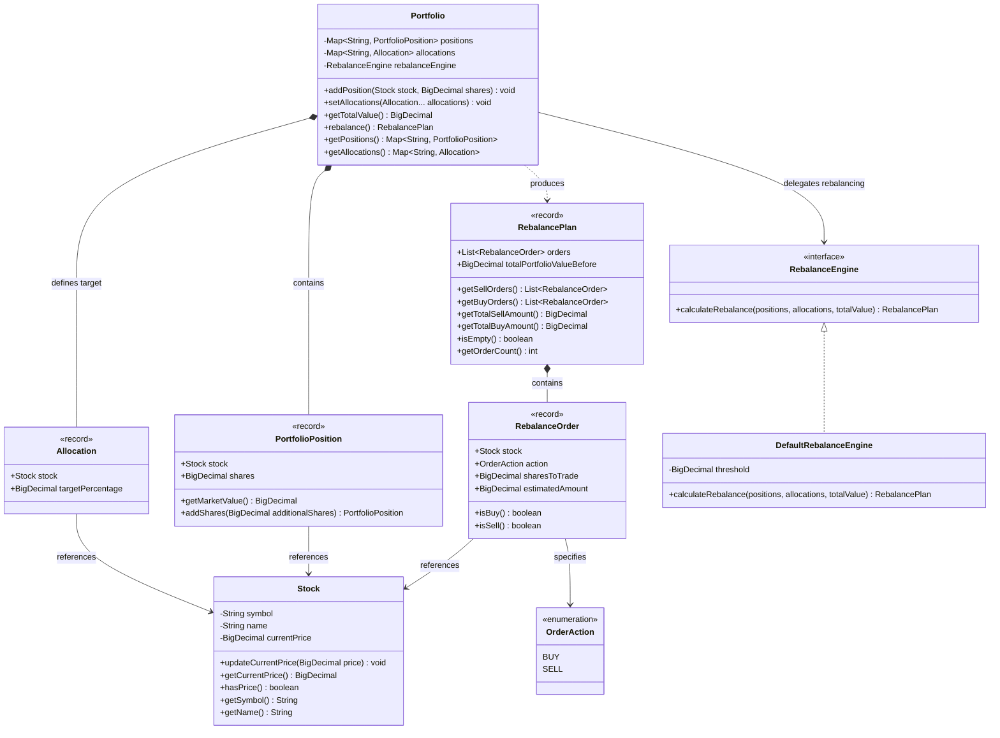

# Portfolio Management & Rebalancing Engine

[](https://openjdk.org/)
[](https://junit.org/junit5/)
[](https://martinfowler.com/tags/domain%20driven%20design.html)
[](https://docs.oracle.com/en/java/javase/17/docs/api/java.base/java/math/BigDecimal.html)

A modular, production-ready Java 17+ domain module for personal investment and trading platforms. It provides automated portfolio valuation, real-time market price intake, target asset allocation enforcement, and a self-financing rebalance algorithm.

---

## Table of Contents
1. [Overview & Challenge Statement](#1-overview--challenge-statement)
2. [Thinking Process & Architectural Rationale](#2-thinking-process--architectural-rationale)
   - [2.1 Spec-Driven Development (SDD)](#21-spec-driven-development-sdd)
   - [2.2 Financial Precision: Absolute Prohibition of Binary Floating-Point](#22-financial-precision-absolute-prohibition-of-binary-floating-point)
   - [2.3 Semantics of the "Current Price" Method in `Stock`](#23-semantics-of-the-current-price-method-in-stock)
   - [2.4 Fractional Shares in Modern Retail Trading Platforms](#24-fractional-shares-in-modern-retail-trading-platforms)
   - [2.5 Self-Financing Rebalancing Order Model](#25-self-financing-rebalancing-order-model)
3. [Class Architecture & Domain Design](#3-class-architecture--domain-design)
   - [3.1 Domain Model Diagram (Mermaid)](#31-domain-model-diagram)
   - [3.2 Design Patterns & Principles Applied](#32-design-patterns--principles-applied)
   - [3.3 Immutability via Java 17 Records](#33-immutability-via-java-17-records)
4. [Test Traceability & Acceptance Criteria](#4-test-traceability--acceptance-criteria)
5. [How to Run & Verify](#5-how-to-run--verify)
6. [LLM & AI Collaboration Disclosure](#6-llm--ai-collaboration-disclosure)

---

## 1. Overview & Challenge Statement

### The Problem
In personal investment and wealth-management applications (such as M1 Finance, Wealthfront, or Robinhood), investors establish a target asset allocation—a model portfolio representing risk appetite and investment strategy (e.g., 40% META, 60% AAPL).

As market prices fluctuate independently, the portfolio drifts away from its target weights. The challenge requires building a clean, robust, and extensible object-oriented module in Java that:
1. Maintains a collection of **Stocks** with their current holdings.
2. Ingests the latest market prices via a dedicated **Current Price** mechanism.
3. Defines a target **allocation** distribution across stocks.
4. Computes a **rebalance** plan that determines which stocks must be **sold** and which must be **bought** to restore balance.
5. Documents the architectural rationale, design trade-offs, and provides full transparency regarding AI-assisted development.

---

## 2. Thinking Process & Architectural Rationale

### 2.1 Spec-Driven Development (SDD)
Before writing production or test code, we adopted **Spec-Driven Development (SDD)**. In financial engineering, ambiguity in requirements (e.g., *"How are trades funded?"*, *"What happens to pennies during rounding?"*, *"How should 0% allocations be handled?"*) leads to severe bugs.

By creating a formal Software Design Document ([SDD](file:///c:/Users/panch/.gemini/antigravity/brain/7f1feabd-14d6-42f2-8445-b1c12ac7328d/portfolio_rebalance_sdd.md)) first, we established:
- Mathematical equations for portfolio equity and asset delta.
- Exact type contracts and scale definitions.
- Failure domains (invalid weights, non-positive share counts, missing quotes).
- A 9-point acceptance test matrix before writing the first line of Java.

---

### 2.2 Financial Precision: Absolute Prohibition of Binary Floating-Point
Binary floating-point types (`float` and `double` governed by IEEE-754) represent decimal numbers as binary fractions. This produces inexact representations for common base-10 numbers:

$$\text{In IEEE-754: } 0.1 + 0.2 = 0.30000000000000004$$

In an asset management engine managing client wealth, accumulated roundoff errors create phantom capital, broken reconciliation balances, and execution failure on broker APIs.

#### Architectural Standard:
- **Zero Primitives in Domain State**: All prices, monetary amounts, target percentages, and share quantities are strictly modeled with `java.math.BigDecimal`.
- **Standardized Precision Scales**:
  - `MONEY_SCALE = 2`: Currency and trade monetary estimates are quantified to cents.
  - `SHARES_SCALE = 4`: Fractional share quantities calculated to 4 decimal places ($0.0001$ share resolution, matching broker standards such as Alpaca and Interactive Brokers).
  - `CALCULATION_SCALE = 8`: Intermediate portfolio equity fractions evaluated at 8 decimal places before final rounding to avoid premature truncation.
- **Banker's Rounding (`RoundingMode.HALF_EVEN`)**:
  Statistically unbiased rounding mode mandated by banking standards. Rounds toward the nearest even neighbor when the discarded fraction is equidistant, eliminating systematic positive or negative inflation across large batches of orders.

---

### 2.3 Semantics of the "Current Price" Method in `Stock`
The challenge specification stipulates:
> *"Assume each Stock has a 'Current Price' method that receives the last available price."*

In financial market feeds (e.g., Bloomberg, Refinitiv, NASDAQ SIP), price feeds are pushed asynchronously. We resolved the naming and semantic contract as follows:
- **Quote Intake**: `Stock.updateCurrentPrice(BigDecimal price)` acts as the market data sink, accepting the latest tick or trade quote with strict validation ($\text{price} > 0$).
- **Quote Inspection**: `Stock.getCurrentPrice()` exposes the latest quote to valuation services, throwing an explicit `IllegalStateException` if the stock has not received a valid market quote prior to portfolio rebalancing.
- **Dynamic Valuation**: Modifying a stock's price immediately impacts the aggregate portfolio value dynamically without requiring manual recalculation or mutable caches.

---

### 2.4 Fractional Shares in Modern Retail Trading Platforms
Traditional legacy brokerages restricted trades to whole integer shares (`1, 2, 3...`). In a modern fintech app, integer constraints introduce significant tracking error:
- If an investor has $\$1,000$ and wants $10\%$ in an asset trading at $\$350$, whole shares force either $0$ shares ($\$0$, $0\%$) or $1$ share ($\$350$, $35\%$), distorting the portfolio.
- **Our Solution**: Native support for **fractional shares** to 4 decimal places. An asset requiring $\$100$ allocation at $\$350$/share generates an order for exactly $0.2857$ shares ($\$99.995 \to \$100.00$), maintaining pinpoint target weight fidelity.

---

### 2.5 Self-Financing Rebalancing Order Model
A critical question in rebalance design is: **How are purchases funded?**

We adopted the **Self-Financing Portfolio Reallocation** model:
1. **Total Portfolio Equity ($V_{\text{total}}$)** is calculated from the aggregate market value of all held assets:
   $$V_{\text{total}} = \sum_{i \in \text{Positions}} (\text{shares}_i \times \text{price}_i)$$
2. **Target Asset Value ($V_{\text{target}, i}$)** is determined by the configured percentage:
   $$V_{\text{target}, i} = V_{\text{total}} \times W_i \quad \text{where} \quad \sum W_i = 1.00$$
3. **Monetary Delta ($\Delta V_i$)**:
   $$\Delta V_i = V_{\text{target}, i} - V_{\text{current}, i}$$
   - **$\Delta V_i < -\text{threshold}$**: Asset is **overweighted** $\implies$ Generate `SELL` order.
   - **$\Delta V_i > +\text{threshold}$**: Asset is **underweighted** $\implies$ Generate `BUY` order.
   - **$|\Delta V_i| \le \text{threshold}$**: Position is balanced $\implies$ No trade generated (prevents sub-penny churn).
4. **Liquidity Invariant (Sells Precede Buys)**:
   In a cash-constrained environment without external deposits, buying new assets requires cash proceeds from selling overweighted ones.
   > **Invariant**: All `SELL` orders are sequenced strictly before any `BUY` order in the resulting `RebalancePlan`.

---

## 3. Class Architecture & Domain Design

### 3.1 Domain Model Diagram



---

### 3.2 Design Patterns & Principles Applied

| Pattern / Principle | Application in Code | Benefit |
|---|---|---|
| **Domain-Driven Design (DDD) Aggregate Root** | [`Portfolio`](file:///c:/Users/panch/OneDrive/Documentos/Gemini/portfolio-rebalance/src/main/java/com/trading/portfolio/service/Portfolio.java) | Encapsulates holdings and target allocations, enforcing invariants (e.g., target allocations must sum exactly to 100%). |
| **Strategy Pattern** | [`RebalanceEngine`](file:///c:/Users/panch/OneDrive/Documentos/Gemini/portfolio-rebalance/src/main/java/com/trading/portfolio/service/RebalanceEngine.java) & [`DefaultRebalanceEngine`](file:///c:/Users/panch/OneDrive/Documentos/Gemini/portfolio-rebalance/src/main/java/com/trading/portfolio/service/DefaultRebalanceEngine.java) | Decouples the portfolio container from specific trading algorithms (e.g., future tax-loss harvesting or integer-lot solvers can be plugged in seamlessly). |
| **Defensive Encapsulation** | `Collections.unmodifiableMap(...)` | Internal state maps are never leaked directly to external callers. |
| **Deterministic Natural Ordering** | `TreeSet<String>` across all tickers | Eliminates non-deterministic test flakiness and guarantees predictable order output across runs. |
| **Self-Financing Liquidity Guarantee** | Segregation into `sellOrders` then `buyOrders` | Ensures the investor never experiences overdraft during trade execution. |

---

### 3.3 Immutability via Java 17 Records
Modern Java records are used for domain value objects:
- [`Allocation`](file:///c:/Users/panch/OneDrive/Documentos/Gemini/portfolio-rebalance/src/main/java/com/trading/portfolio/model/Allocation.java): Immutable target weight specification with range assertion $[0.0, 1.0]$.
- [`PortfolioPosition`](file:///c:/Users/panch/OneDrive/Documentos/Gemini/portfolio-rebalance/src/main/java/com/trading/portfolio/model/PortfolioPosition.java): Immutable asset holding; share adjustments return a new record instance (`addShares`).
- [`RebalanceOrder`](file:///c:/Users/panch/OneDrive/Documentos/Gemini/portfolio-rebalance/src/main/java/com/trading/portfolio/model/RebalanceOrder.java): Immutable trade order record with validation on strictly positive quantities.
- [`RebalancePlan`](file:///c:/Users/panch/OneDrive/Documentos/Gemini/portfolio-rebalance/src/main/java/com/trading/portfolio/model/RebalancePlan.java): Immutable execution batch with convenience filtering methods (`getSellOrders()`, `getBuyOrders()`).

---

## 4. Test Traceability & Acceptance Criteria

Every requirement from the initial design specification and edge-case boundary analysis is backed by comprehensive unit tests in [`PortfolioRebalanceTest.java`](file:///c:/Users/panch/OneDrive/Documentos/Gemini/portfolio-rebalance/src/test/java/com/trading/portfolio/PortfolioRebalanceTest.java):

| Test ID | Scenario | Input Description | Expected Behavior & Verification | Status |
|---|---|---|---|:---:|
| **TC-01** | **Base Scenario (Challenge Spec)** | 10 META @ $100 ($1,000), 10 AAPL @ $100 ($1,000). Total: $2,000.<br>Target: 40% META ($800), 60% AAPL ($1,200). | Generates exactly 1 `SELL` for 2.0 META (-$200) and 1 `BUY` for 2.0 AAPL (+$200). Cash balance is perfectly neutral ($200 in = $200 out). | Passed |
| **TC-02** | **Already Balanced Portfolio** | Portfolio weights match target allocations exactly. | Returns an empty `RebalancePlan` with 0 orders and zero traded volume. | Passed |
| **TC-03** | **Unowned Asset Acquisition** | Target includes GOOGL (30%) not currently held in portfolio. | Generates a `BUY` order for 2.0 GOOGL funded by selling overweighted assets. | Passed |
| **TC-04** | **Discontinued Asset Liquidation** | Portfolio holds NFLX, but target allocation omits it (0% target). | Completely liquidates NFLX (sells 100% of shares) without leaving dust remnants. | Passed |
| **TC-05** | **Allocation Validation Invariant** | Allocations summing to 90%, 110%, negative values, or duplicate tickers. | Fails fast with `IllegalArgumentException` and descriptive error messages. | Passed |
| **TC-06** | **Missing or Invalid Market Price** | Stock without price quote, price $\le 0$, or null price. | Fails fast with `IllegalStateException` or `IllegalArgumentException`. | Passed |
| **TC-07** | **Banker's Rounding Precision** | 3 assets with fractional target weights (33.33%, 33.33%, 33.34%). | `RoundingMode.HALF_EVEN` preserves exact cents ($2,000.10 sold == $2,000.10 bought) without cent leakage. | Passed |
| **TC-08** | **Liquidity Ordering Invariant** | Multiple assets requiring both sells and buys (AAA, BBB, CCC, DDD). | Asserts that every single `SELL` order strictly precedes any `BUY` order in the plan. | Passed |
| **TC-09** | **Dynamic Price Update** | Market price of META doubles from $100 to $200. | Portfolio valuation dynamically updates to $3,000; rebalancing generates fresh orders matching new valuation. | Passed |
| **Edge-01** | **Empty Portfolio** | Rebalancing an empty portfolio with defined targets. | Returns an empty plan with zero value without throwing exceptions. | Passed |
| **Edge-02** | **Drift within Noise Threshold** | Minor market drift ($0.25) within configured threshold ($1.00). | Suppresses small noise trades to avoid fee erosion. | Passed |
| **Edge-03** | **Rebalance Without Target Allocations** | Calling rebalance before defining allocations. | Fails fast with `IllegalStateException`. | Passed |
| **Edge-04** | **Position Accumulation** | Adding shares for an existing ticker (case-insensitive "meta" / "META"). | Accumulates shares into a single consolidated position. | Passed |

---

## 5. How to Run & Verify

This repository is completely self-contained. It includes the **Maven Wrapper (`mvnw` / `mvnw.cmd`)**, so **no local Maven installation is required**. The only prerequisite is **Java JDK 17** (or newer) installed on your system.

### Running Tests

#### On Linux / macOS:
```bash
./mvnw clean test
```

#### On Windows (PowerShell / Command Prompt):
```powershell
.\mvnw.cmd clean test
```

### Expected Output
```text
[INFO] -------------------------------------------------------
[INFO]  T E S T S
[INFO] -------------------------------------------------------
[INFO] Running com.trading.portfolio.PortfolioRebalanceTest
[INFO] Running com.trading.portfolio.PortfolioRebalanceTest$EdgeCasesTest
[INFO] Tests run: 13, Failures: 0, Errors: 0, Skipped: 0
[INFO] ------------------------------------------------------------------------
[INFO] BUILD SUCCESS
[INFO] ------------------------------------------------------------------------
```

---

## 6. LLM & AI Collaboration Disclosure

In accordance with the challenge requirement:
> *"Important: If you use LLMs that’s ok, but you must share the conversations"*

This project was developed through an interactive, multi-agent AI pair-programming session using **Google Antigravity** and the **Orquestador (Spec-Driven Development)** framework.

- The complete, verbatim chronological transcript of prompts, architectural debates, decision logs, and step-by-step implementation milestones is preserved in:
  👉 **[`ai-transcript.md`](file:///c:/Users/panch/OneDrive/Documentos\Gemini\portfolio-rebalance\ai-transcript.md)**

### Key Highlights of the AI Collaboration:
1. **Spec-Driven Guidance**: We engaged the AI not to write code immediately, but to act as a financial systems architect, interviewing us on edge cases (self-financing vs. external cash, fractional vs. integer shares, IEEE-754 precision).
2. **Deterministic Quality Gates**: Every step was verified against JUnit 5 assertions and domain invariants before progressing to downstream tasks.
3. **Zero Hallucination / Zero Broken Dependencies**: Modern standard Java 17 features (records, enhanced pattern matching) were combined with clean Maven dependency management.
