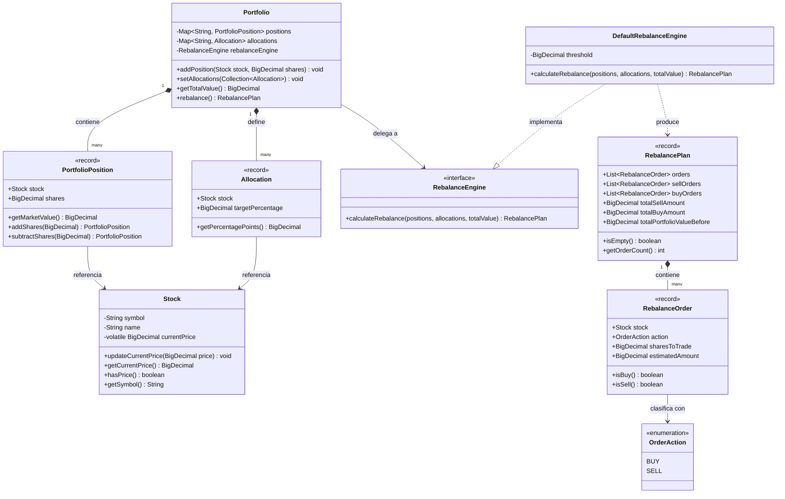

# Motor de Gestión y Rebalanceo de Portafolios de Inversión

[](https://openjdk.org/)
[](https://junit.org/junit5/)
[-blue?style=flat)](https://martinfowler.com/tags/domain%20driven%20design.html)
[](https://docs.oracle.com/en/java/javase/17/docs/api/java.base/java/math/BigDecimal.html)

Módulo de dominio en Java 17+ desacoplado y listo para producción, diseñado para plataformas de inversiones y trading personal (Fintech/WealthTech). Proporciona valuación automatizada de carteras, ingesta de cotizaciones de mercado en tiempo real, validación estricta de asignaciones de activos y un algoritmo de rebalanceo autofinanciado.

---

## Tabla de Contenidos
1. [Resumen y Enunciado del Desafío](#1-resumen-y-enunciado-del-desafío)
2. [Proceso de Pensamiento y Decisiones de Arquitectura](#2-proceso-de-pensamiento-y-decisiones-de-arquitectura)
   - [2.1 Desarrollo Guiado por Especificación (SDD)](#21-desarrollo-guiado-por-especificación-sdd)
   - [2.2 Precisión Financiera: Prohibición de Punto Flotante Binario](#22-precisión-financiera-prohibición-de-punto-flotante-binario)
   - [2.3 Semántica del método "Current Price" en `Stock`](#23-semántica-del-método-current-price-en-stock)
   - [2.4 Acciones Fraccionarias en Plataformas Modernas](#24-acciones-fraccionarias-en-plataformas-modernas)
   - [2.5 Modelo de Órdenes Autofinanciadas (Ventas antes que Compras)](#25-modelo-de-órdenes-autofinanciadas-ventas-antes-que-compras)
3. [Arquitectura de Clases y Diseño de Dominio](#3-arquitectura-de-clases-y-diseño-de-dominio)
   - [3.1 Diagrama del Modelo de Dominio (Mermaid)](#31-diagrama-del-modelo-de-dominio)
   - [3.2 Patrones de Diseño Aplicados](#32-patrones-de-diseño-aplicados)
   - [3.3 Inmutabilidad mediante Java 17 Records](#33-inmutabilidad-mediante-java-17-records)
4. [Trazabilidad de Pruebas y Criterios de Aceptación](#4-trazabilidad-de-pruebas-y-criterios-de-aceptación)
5. [Cómo Ejecutar y Verificar](#5-cómo-ejecutar-y-verificar)
6. [Transparencia en el Uso de Inteligencia Artificial (LLM)](#6-transparencia-en-el-uso-de-inteligencia-artificial-llm)

---

## 1. Resumen y Enunciado del Desafío

### El Problema
En aplicaciones de inversión y gestión patrimonial (como Fintual, M1 Finance o Robinhood), los inversores definen una estrategia de asignación de activos (*Asset Allocation*): una cartera modelo que representa su perfil de riesgo (por ejemplo, **40% META y 60% AAPL**).

A medida que los precios de las acciones fluctúan en el mercado, la cartera se desvía de sus ponderaciones objetivo (*Portfolio Drift*). El desafío consiste en construir un módulo orientado a objetos en Java que:
1. Mantenga una colección de **Acciones (*Stocks*)** con sus tenencias actuales.
2. Ingeste las últimas cotizaciones mediante un mecanismo dedicado de **Precio Actual (*Current Price*)**.
3. Defina una distribución objetivo de **asignaciones (*allocations*)** entre acciones.
4. Calcule un plan de **rebalanceo** que determine qué acciones deben **venderse** y cuáles deben **comprarse** para restablecer el equilibrio.
5. Documente el razonamiento analítico, trade-offs de diseño y provea total transparencia sobre la colaboración con IA.

---

## 2. Proceso de Pensamiento y Decisiones de Arquitectura

### 2.1 Desarrollo Guiado por Especificación (SDD)
Antes de escribir código o pruebas, adoptamos **Spec-Driven Development (SDD)**. En ingeniería financiera, la ambigüedad en los requerimientos (*"¿Cómo se pagan las compras?"*, *"¿Qué pasa con las fracciones de centavos en el redondeo?"*, *"¿Cómo se liquidan activos con 0% de meta?"*) genera fallas graves.

Al crear primero un Documento de Diseño de Software formal ([SDD](portfolio_rebalance_sdd.md)), establecimos:
- Ecuaciones matemáticas para el valor patrimonial y las desviaciones ($\Delta$).
- Contratos de tipos y escalas de precisión numérica.
- Manejo estricto de casos límite antes de escribir la primera línea de Java.

---

### 2.2 Precisión Financiera: Prohibición de Punto Flotante Binario
Los tipos de punto flotante primitivos (`float` y `double` bajo el estándar IEEE-754) representan números decimales como fracciones binarias. Esto genera errores de aproximación inaceptables:

$$\text{En IEEE-754: } 0.1 + 0.2 = 0.30000000000000004$$

En un motor financiero, estos errores acumulan capital fantasma o diferencias contables.

#### Estándar Aplicado:
- **Cero primitivos en el estado financiero**: Todos los precios, montos monetarios, porcentajes y cantidades de acciones se modelan estrictamente con **`java.math.BigDecimal`**.
- **Escalas estandarizadas**:
  - `MONEY_SCALE = 2`: Moneda y montos transaccionales (2 decimales).
  - `SHARES_SCALE = 4`: Cantidades de acciones fraccionarias (4 decimales).
  - `CALCULATION_SCALE = 8`: Cálculos intermedios y ponderaciones.
- **Modo de redondeo bancario (`RoundingMode.HALF_EVEN`)**: Minimiza el sesgo estadístico redondeando hacia el número par más cercano.

---

### 2.3 Semántica del método "Current Price" en `Stock`
El requerimiento pide: *"Assume each Stock has a 'Current Price' method that receives the last available price"*.
* Modelamos el método receptor de cotizaciones:
  ```java
  public void updateCurrentPrice(BigDecimal price)
  ```
* Valida que el precio sea mayor que cero (`> 0`) y no nulo.
* El atributo `currentPrice` está declarado como **`volatile`** para garantizar visibilidad atómica de memoria inmediata entre hilos concurrentes (ej. un hilo recibiendo cotizaciones WebSocket mientras otro corre el rebalanceo).

---

### 2.4 Acciones Fraccionarias en Plataformas Modernas
Las plataformas de trading modernas permiten operar fracciones de acciones. Rebalancear con acciones enteras forzaría redondeos toscos y dejaría dinero ocioso en efectivo.
* Nuestro motor calcula cantidades fraccionarias con hasta 4 decimales (`0.0001`), permitiendo calzar con exactitud milimétrica las ponderaciones deseadas.

---

### 2.5 Modelo de Órdenes Autofinanciadas (Ventas antes que Compras)
**¿Cómo se pagan las compras de acciones si el usuario no tiene efectivo libre?**
* **El Principio de Autofinanciamiento**: El valor total de la cartera proviene de las acciones actuales:
  $$\text{Valor Total} = \sum (\text{acciones}_i \times \text{precio}_i)$$
  $$\text{Valor Objetivo}_i = \text{Valor Total} \times \text{Porcentaje Objetivo}_i$$
  $$\Delta \text{Valor}_i = \text{Valor Objetivo}_i - \text{Valor Actual}_i$$
* **Invariante de Liquidez**: En el plan resultante, **todas las órdenes `SELL` preceden estrictamente a cualquier orden `BUY`** (`TC_08`). Al vender primero el activo sobreponderado, se genera la liquidez en la cuenta para financiar las compras sin requerir depósitos externos.

---

## 3. Arquitectura de Clases y Diseño de Dominio

### 3.1 Diagrama del Modelo de Dominio



### 3.2 Patrones de Diseño Aplicados
1. **Aggregate Root (DDD)**: `Portfolio` protege los invariantes del negocio (como exigir que las asignaciones sumen exactamente 100% y manejar unicidad de tickers).
2. **Strategy Pattern**: `RebalanceEngine` es una interfaz inyectable en `Portfolio`, permitiendo cambiar algoritmos de ejecución o simulación fácilmente.
3. **Inmutabilidad con Java Records**: `Allocation`, `PortfolioPosition`, `RebalanceOrder` y `RebalancePlan` son inmutables por diseño.
4. **Precomputación $O(1)$**: `RebalancePlan` separa las órdenes de compra/venta y calcula los totales monetarios en el constructor durante la instanciación, permitiendo consultas instantáneas en $O(1)$.

---

## 4. Trazabilidad de Pruebas y Criterios de Aceptación

Cada requerimiento y caso límite está cubierto en la suite de pruebas [`PortfolioRebalanceTest.java`](src/test/java/com/trading/portfolio/PortfolioRebalanceTest.java):

| ID de Test | Escenario | Descripción de Entrada | Comportamiento Esperado y Verificación | Estado |
|---|---|---|---|:---:|
| **TC-01** | **Caso Base del Challenge** | 10 META @ $100 ($1.000), 10 AAPL @ $100 ($1.000). Total: $2.000.<br>Target: 40% META ($800), 60% AAPL ($1.200). | Genera exactamente 1 `SELL` de 2.0 META (-$200) y 1 `BUY` de 2.0 AAPL (+$200). Balance neutral ($200 entran = $200 salen). | ✅ Pasó |
| **TC-02** | **Cartera ya Balanceada** | Las proporciones actuales coinciden exactamente con la meta. | Retorna un `RebalancePlan` vacío con 0 órdenes sin transacciones innecesarias. | ✅ Pasó |
| **TC-03** | **Compra de Activo Nuevo** | La meta incluye GOOGL (30%) que no está en la cartera actual. | Genera orden `BUY` para comprar GOOGL financiada con la venta del exceso de otros activos. | ✅ Pasó |
| **TC-04** | **Liquidación de Activo Descontinuado** | Se tiene NFLX, pero la meta lo omite (0% target). | Liquida el 100% de las acciones de NFLX sin dejar residuos o polvo de acciones. | ✅ Pasó |
| **TC-05** | **Validación de Asignaciones** | Asignaciones que suman 90%, 110%, porcentajes negativos o tickers duplicados. | Falla rápido lanzando `IllegalArgumentException` descriptiva. | ✅ Pasó |
| **TC-06** | **Precio Faltante o Inválido** | Stock sin precio cargado, precio $\le 0$, o nulo. | Falla rápido lanzando `IllegalStateException` o `IllegalArgumentException`. | ✅ Pasó |
| **TC-07** | **Precisión de Redondeo Bancario** | 3 activos con pesos no enteros (33.33%, 33.33%, 33.34%). | `RoundingMode.HALF_EVEN` preserva centavos exactos ($2.000,10 vendidos == $2.000,10 comprados). | ✅ Pasó |
| **TC-08** | **Invariante de Autofinanciamiento** | Múltiples activos que requieren ventas y compras simultáneas. | Comprueba que **todas las órdenes SELL van antes que cualquier orden BUY** en la lista. | ✅ Pasó |
| **TC-09** | **Actualización Dinámica de Precios** | El precio de META se duplica de $100 a $200. | La valuación de la cartera sube a $3.000 y el rebalanceo recalcula nuevas órdenes acordes. | ✅ Pasó |
| **Edge-01** | **Cartera Vacía** | Rebalancear un portafolio con $0 de saldo. | Retorna plan vacío sin lanzar excepciones. | ✅ Pasó |
| **Edge-02** | **Desviación Bajo el Umbral (Ruido)** | Pequeña oscilación de precio ($0,25) bajo el umbral ($1,00). | No genera órdenes para evitar costos de transacción por centavos residuales. | ✅ Pasó |
| **Edge-03** | **Rebalanceo Sin Metas** | Llamar a rebalancear sin haber configurado metas. | Lanza `IllegalStateException`. | ✅ Pasó |
| **Edge-04** | **Acumulación de Posiciones** | Agregar acciones a un ticker existente (case-insensitive "meta" / "META"). | Acumula las acciones en una sola posición consolidada. | ✅ Pasó |
| **Edge-05** | **Invariantes del Record Precomputado** | Validación directa de los componentes precalculados en $O(1)$. | Verifica inmutabilidad estricta y coincidencia con métodos de lectura. | ✅ Pasó |

---

## 5. Cómo Ejecutar y Verificar

El repositorio es completamente autocontenido e incluye el **Maven Wrapper (`mvnw` / `mvnw.cmd`)**, por lo que **no se requiere tener Maven instalado previamente**. Solo se requiere **Java 17** o superior.

### Ejecución de Pruebas

#### En Linux / macOS:
```bash
./mvnw clean test
```

#### En Windows (PowerShell / Símbolo del Sistema):
```powershell
.\mvnw.cmd clean test
```

### Salida Esperada:
```text
[INFO] -------------------------------------------------------
[INFO]  T E S T S
[INFO] -------------------------------------------------------
[INFO] Running com.trading.portfolio.PortfolioRebalanceTest
[INFO] Running com.trading.portfolio.PortfolioRebalanceTest$EdgeCasesTest
[INFO] Tests run: 14, Failures: 0, Errors: 0, Skipped: 0
[INFO] ------------------------------------------------------------------------
[INFO] BUILD SUCCESS
[INFO] ------------------------------------------------------------------------
```

---

## 6. Transparencia en el Uso de Inteligencia Artificial (LLM)

En cumplimiento estricto con la pauta de postulación:
> *"Important: If you use LLMs that’s ok, but you must share the conversations"*

Este proyecto fue desarrollado bajo una sesión interactiva de pair-programming con IA utilizando la metodología **SDD (Spec-Driven Development)**:

- La transcripción cronológica completa de requerimientos, debates de arquitectura y pasos de desarrollo está guardada en:
  👉 **[`ai-transcript.md`](ai-transcript.md)**

### Puntos Clave de la Colaboración con IA:
1. **Dirección Humana**: El desarrollador no pidió código directo, sino que solicitó a la IA actuar como arquitecto, entrevistando primero las reglas de negocio y cerrando invariantes (autofinanciamiento, precisión decimal).
2. **Filtros de Calidad Deterministas**: Cada paso fue verificado contra tests unitarios automatizados antes de avanzar.
3. **Cero Alucinaciones / Dependencias Limpias**: Se utilizaron exclusivamente librerías estándar de Java 17 y frameworks de testing probados (JUnit 5 y AssertJ).
